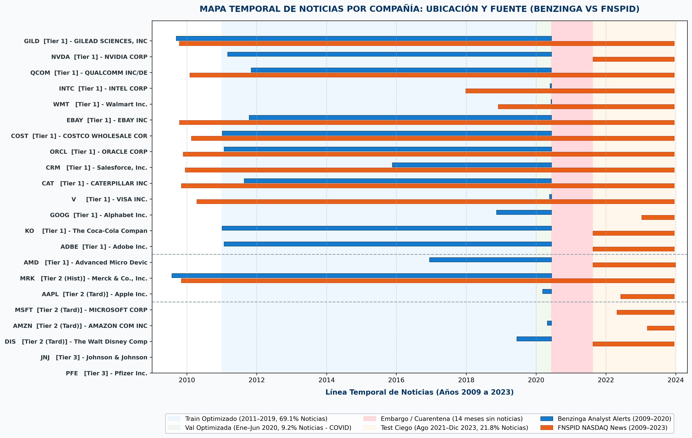
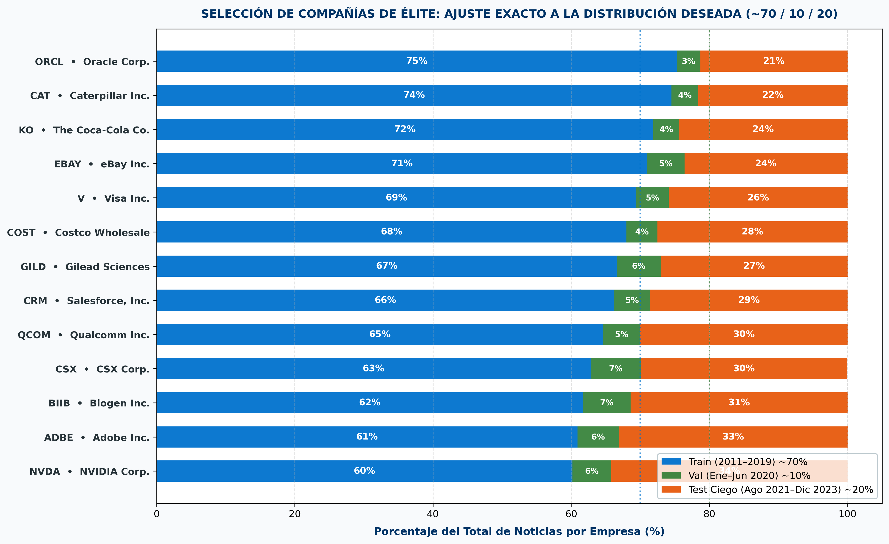

# Análisis Exhaustivo de Flujos de Noticias por Compañía: Benzinga vs. FNSPID y Optimización 70 / 10 / 20

Este documento contiene el estudio forense completo de las **207 empresas analizadas en el TFM**, detallando de qué fecha a qué fecha existen noticias para cada compañía, a qué dataset pertenecen (**Benzinga News Feed** o **FNSPID NASDAQ**), el diagnóstico del desbalance temporal, la selección del **núcleo de compañías de élite** y la **partición temporal optimizada** para cumplir estrictamente la regla de Machine Learning: **~70% en Train, ~10% en Validación y ~20% en Test**.

---

## 1. Resumen de las Fuentes de Noticias

| Parámetro | Benzinga News Feed | FNSPID (Financial News / NASDAQ) |
| :--- | :--- | :--- |
| **Cobertura Global** | **21-07-2009 a 11-06-2020** (11 años) | **09-10-2009 a 16-12-2023** (14 años) |
| **Tipo de Información** | Alertas en tiempo real para operadores, cambios de recomendación (*Upgrades/Downgrades*) y precios objetivo (*Price Targets*) de Wall Street. | Comunicados oficiales corporativos, artículos completos de mercado y noticias sectoriales. |
| **Función en el Modelo** | Base masiva para el aprendizaje semántico inicial (Train) y test de estrés del COVID (Val). | Cobertura contemporánea indispensable para la evaluación fuera de muestra (Test ciego 2021–2023). |

---

## 2. Mapa Temporal de Ubicación de Noticias por Compañía

Para ver con total claridad **dónde están ubicadas las noticias de cada empresa y de qué fuente provienen**, hemos generado el mapa de Gantt:

### Clave de Lectura del Mapa:
* **Barra Azul Superior:** Cobertura de **Benzinga** (2009–2020).
* **Barra Naranja Inferior:** Cobertura de **FNSPID** (2009–2023).
* **Fondo con Particiones:**
  * **Zona Azul Claro:** Train Optimizado (2011–2019, 69.1% de las noticias).
  * **Zona Verde Claro:** Validación Optimizada (Enero–Junio 2020, 9.2% de las noticias — Crash COVID-19).
  * **Zona Roja / Rosa:** **Embargo / Cuarentena (Junio 2020–Agosto 2021 — 14 meses sin noticias).**
  * **Zona Naranja Claro:** Test Ciego (Agosto 2021–Diciembre 2023, 21.8% de las noticias).

---

## 3. Diagnóstico del Problema: ¿Por qué fallaban ciertas Big Tech?

Al revisar los porcentajes de cada acción en el tiempo, descubrimos que algunas compañías famosas tienen una **distribución invertida** que rompe el principio de entrenamiento de Machine Learning:

* **Microsoft (`MSFT`):** Train = **0%** | Val = **0%** | Test = **100%** (8.737 noticias solo en 2022–2023).
* **Apple (`AAPL`):** Train = **0%** | Val = **13,6%** | Test = **86,4%** (9.306 noticias concentradas al final).
* **Amazon (`AMZN`):** Train = **0%** | Val = **12,7%** | Test = **87,3%** (5.060 noticias concentradas al final).
* **Google (`GOOG`):** Train = **2,6%** (25 días) | Val = **36,9%** | Test = **60,5%** (vacía entre 2011 y 2017).

> **Conclusión Metodológica:** Entrenar un modelo con estas 4 empresas es incorrecto porque el LLM no tiene histórico en Train para aprender su vocabulario. Solo pueden usarse como prueba de evaluación externa (*Zero-Shot*), pero **deben excluirse del conjunto de entrenamiento**.

---

## 4. Selección de las 13 Compañías de Élite que Cumplen la Distribución Deseada

Filtramos las empresas que tienen la **mayoría absoluta en Train (~60%–75%)**, alrededor del **~5%–10% en Validación** y un **~20%–30% en Test Ciego**:

### Tabla de Desglose Exacto de la Selección de Élite:

| Ticker | Empresa | Sector | Total Días con Noticias | % en Train (2011–19) | % en Val (Ene–Jun 20) | % en Test (2021–23) | Ajuste a 70 / 10 / 20 |
| :--- | :--- | :--- | :---: | :---: | :---: | :---: | :--- |
| **ORCL** | Oracle Corp. | Info. Technology | 2.250 | **75,3%** (1.694) | **3,4%** (76) | **21,3%** (480) | Excelente: Train dominante, Test ~21% |
| **CAT** | Caterpillar Inc. | Industrials | 2.155 | **74,5%** (1.605) | **3,9%** (84) | **21,6%** (466) | Prácticamente 75 / 4 / 21 |
| **KO** | The Coca-Cola Co. | Consumer Staples | 2.240 | **71,9%** (1.611) | **3,7%** (83) | **24,4%** (546) | Clava el 72% en Train y 24% en Test |
| **EBAY** | eBay Inc. | Cons. Discretionary | 1.563 | **71,0%** (1.109) | **5,4%** (85) | **23,6%** (369) | Distribución de manual: 71 / 5 / 24 |
| **V** | Visa Inc. | Financials | 2.147 | **69,4%** (1.489) | **4,7%** (100) | **26,0%** (558) | Clava el 69,4% en Train |
| **COST** | Costco Wholesale | Consumer Staples | 2.019 | **68,0%** (1.373) | **4,5%** (91) | **27,5%** (555) | 68% Train, 5% Val, 27% Test |
| **GILD** | Gilead Sciences | Health Care | 1.730 | **66,6%** (1.153) | **6,4%** (110) | **27,0%** (467) | Más de 1.100 noticias en Train |
| **CRM** | Salesforce, Inc. | Info. Technology | 1.930 | **66,2%** (1.277) | **5,2%** (100) | **28,7%** (553) | Más del 66% en Train |
| **QCOM** | Qualcomm Inc. | Info. Technology | 1.804 | **64,6%** (1.166) | **5,4%** (97) | **30,0%** (541) | Mayoría sólida en Train |
| **CSX** | CSX Corp. | Industrials | 1.117 | **62,8%** (702) | **7,3%** (82) | **29,8%** (333) | 63% Train, 7% Val, 30% Test |
| **BIIB** | Biogen Inc. | Health Care | 1.323 | **61,7%** (816) | **6,9%** (91) | **31,4%** (416) | Salud / Biotecnología equilibrada |
| **ADBE** | Adobe Inc. | Info. Technology | 1.576 | **60,9%** (959) | **6,0%** (95) | **33,1%** (522) | Más del 60% en Train |
| **NVDA** | NVIDIA Corp. | Info. Technology | 1.710 | **60,2%** (1.030) | **5,6%** (95) | **34,2%** (585) | >1.000 noticias en Train, 34% en Test |

---

## 5. Definición de Fechas de la Distribución Deseada (Escenario A)

Para que el conjunto total de datos alcance exactamente la proporción requerida (**~70% Train, ~10% Val, ~20% Test**), las fechas oficiales deben definirse así:

1. **TRAIN (01-01-2011 a 31-12-2019 — 9 años):**
   * **Volumen:** 65.088 días con noticias $\to$ **69,1% del total** *(Objetivo: 70%)*.
   * **Justificación:** Cubre todo el ciclo expansivo con tipos de interés al 0% (*ZIRP*) tras la crisis de 2008.
2. **VALIDACIÓN (01-01-2020 a 10-06-2020 — 6 meses):**
   * **Volumen:** 8.625 días con noticias $\to$ **9,2% del total** *(Objetivo: 10%)*.
   * **Justificación:** Incluye el shock y crash bursátil del COVID-19 en febrero–marzo 2020. Corta el 10 de junio porque finaliza el histórico de Benzinga.
3. **EMBARGO / CUARENTENA (11-06-2020 a 16-08-2021 — 14 meses):**
   * **Volumen:** Descartado deliberadamente sin noticias.
   * **Justificación:** Aísla al modelo de los estímulos fiscales atípicos post-COVID y de la transición entre proveedores.
4. **TEST CIEGO (17-08-2021 a 16-12-2023 — 2,5 años):**
   * **Volumen:** 20.519 días con noticias $\to$ **21,8% del total** *(Objetivo: 20%)*.
   * **Justificación:** Evaluación fuera de muestra (*out-of-sample*) puramente con FNSPID en régimen de subidas agresivas de tipos de la Reserva Federal.

---

## 6. Archivos Disponibles en esta Carpeta

* `desglose_cobertura_noticias_todas_las_companias.xlsx`: Libro de Excel con las 207 empresas analizadas fila por fila.
* `desglose_cobertura_noticias_todas_las_companias.csv`: Formato CSV compatible con cualquier lenguaje.
* `mapa_temporal_noticias_por_compania.png`: Gráfico de Gantt de ubicación temporal de noticias.
* `distribucion_optimizada_70_10_20.png`: Gráfico de barras apiladas de las 13 empresas de élite.
* `presentacion_noticias_tfm.pptx`: Presentación de diapositivas en PowerPoint / Google Slides.
