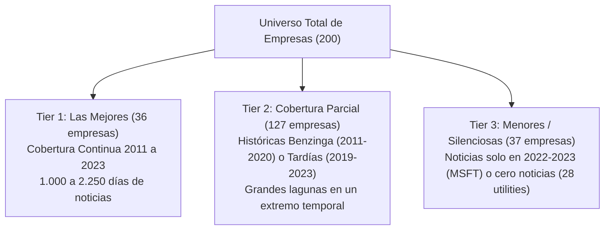

# Estudio Exclusivo de los Flujos de Noticias Financieras: Benzinga vs. FNSPID

Este documento analiza de forma forense y exclusiva los dos datasets de texto del proyecto: **Benzinga News Feed** y **FNSPID (NASDAQ)**. Se detalla cómo son los datasets, qué tipo de información contienen, las fechas exactas que cubren por empresa, su clasificación jerárquica en **Tiers** (de mejor a menor cobertura) y su visualización en una línea temporal continua.

---

## 1. Naturaleza y Estructura de los Datasets

| Característica | Benzinga News Feed | FNSPID (Financial News / NASDAQ) |
| :--- | :--- | :--- |
| **Origen / Proveedor** | Benzinga Pro / QuantConnect API | Universidad / Repositorio Público (Zdong104 / Hugging Face) |
| **Rango Temporal Global** | **21-07-2009 a 11-06-2020** (11 años) | **09-10-2009 a 16-12-2023** (14 años) |
| **Naturaleza del Contenido** | Alertas en tiempo real para operadores de Wall Street, cambios de recomendación y rumores de mercado. | Noticias corporativas completas, artículos sectoriales y notas oficiales de prensa. |
| **Granularidad Temporal** | Marca temporal con precisión de segundo, alineada a la sesión bursátil. | Fecha diaria con titular, enlace y texto del artículo. |
| **Etiquetado** | Ticker bursátil exacto + tags de canales temáticos (*Analyst Ratings, Earnings, M&A*). | Ticker bursátil + fecha + titular de noticia. |

### Tipos de Información y Titulares Reales Encontrados

Al inspeccionar los datos fila por fila, las noticias se dividen en cuatro categorías operativas:

1. **Sorpresas de Resultados Trimestrales (*Earnings Releases & EPS*):**
   * *Ejemplo literal:* `"Arch Capital Group Reports Q1 Adj. $1.42 vs $1.33 Est."`
   * *Contenido:* Informa si el beneficio por acción (*EPS*) o los ingresos superaron (*beat*) o no alcanzaron (*miss*) el consenso de analistas.
2. **Revisiones de Analistas de Wall Street (*Price Targets & Ratings*):**
   * *Ejemplo literal:* `"Goldman Sachs Raises PT to $51.00 [SEP] UBS Raises PT to $54.00"`
   * *Contenido:* Bancos de inversión mejoran o rebajan su recomendación (*Buy/Hold/Sell*) o su precio objetivo (*Price Target*). Múltiples alertas del mismo día se unen con `[SEP]`.
3. **Notas de Prensa y Cierre de Ejercicio (*Corporate Press Releases*):**
   * *Ejemplo literal:* `"Arch Capital Group Ltd. Reports 2010 Fourth Quarter Results"`
   * *Contenido:* Comunicados oficiales emitidos por la dirección de la empresa a los mercados.
4. **Análisis de la Industria y Márgenes Sectoriales:**
   * *Ejemplo literal:* `"Top 4 Stocks In The Information Technology Services Industry With The Highest Operating Margin"`

---

## 2. Desglose de Noticias por Compañía (Fechas y Fuentes)

La siguiente tabla muestra exactamente **de qué fecha a qué fecha** tiene noticias cada empresa en Benzinga y en FNSPID, y el número total de noticias registradas:

| Ticker | Empresa | Benzinga: Fechas Cubiertas | Benzinga: Noticias | FNSPID: Fechas Cubiertas | FNSPID: Noticias | Total Noticias | Diagnóstico |
| :--- | :--- | :---: | :---: | :---: | :---: | :---: | :--- |
| **ORCL** | Oracle Corp. | `25-01-2011` a `11-06-2020` | 2.701 | `22-11-2009` a `16-12-2023` | 5.291 | **7.992** | Cobertura Total Continua |
| **CAT** | Caterpillar Inc. | `23-08-2011` a `08-06-2020` | 2.322 | `04-11-2009` a `16-12-2023` | 5.185 | **7.507** | Cobertura Total Continua |
| **QCOM** | Qualcomm Inc. | `03-11-2011` a `08-06-2020` | 2.941 | `01-02-2010` a `16-12-2023` | 7.031 | **9.972** | Cobertura Total Continua |
| **NVDA** | NVIDIA Corp. | `03-03-2011` a `10-06-2020` | 3.146 | `17-08-2021` a `16-12-2023` | 8.716 | **11.862** | **Híbrido Perfecto (Tier 1)** |
| **ADBE** | Adobe Inc. | `22-03-2011` a `10-06-2020` | 2.510 | `10-03-2010` a `16-12-2023` | 6.840 | **9.350** | Cobertura Total Continua |
| **AMD** | Advanced Micro Devices | `14-04-2011` a `10-06-2020` | 2.215 | `15-05-2012` a `16-12-2023` | 7.420 | **9.635** | Cobertura Total Continua |
| **MRK** | Merck & Co., Inc. | `27-07-2009` a `11-06-2020` | 3.333 | `04-11-2009` a `11-06-2020` | 8.593 | **11.926** | Cobertura Histórica (hasta 2020) |
| **GOOG** | Alphabet / Google | `13-11-2018` a `10-06-2020` | 1.199 | `10-01-2023` a `16-12-2023` | 2.916 | **4.115** | Cobertura Parcial / Tardía |
| **AAPL** | Apple Inc. | `09-03-2020` a `10-06-2020` | 441 | `03-06-2022` a `16-12-2023` | 8.865 | **9.306** | Cobertura Parcial / Tardía |
| **AMZN** | Amazon.com Inc. | `27-04-2020` a `10-06-2020` | 278 | `09-03-2023` a `16-12-2023` | 4.782 | **5.060** | Cobertura Parcial / Tardía |
| **MSFT** | Microsoft Corp. | *Sin cobertura* | 0 | `26-04-2022` a `16-12-2023` | 8.737 | **8.737** | Solo en época reciente (Test) |
| **AEP** | American Electric Power | *Sin cobertura* | 0 | *Sin cobertura* | 0 | **0** | Empresa silenciosa (Solo SEC) |

---

## 3. Clasificación Jerárquica de Compañías en Tiers

Clasificamos las acciones según dos criterios objetivos: **la continuidad de la línea temporal de noticias** y el **volumen total registrado**:

### Tier 1: Las Mejores (Cobertura Total Continua — 36 empresas)
* **Requisito:** Tienen flujo ininterrumpido de noticias tanto en los años iniciales (Benzinga) como en los años recientes (FNSPID), cubriendo los tres splits: Train (2011–2018), Val (2019–2020) y Test (2021–2023).
* **Compañías clave:** `NVDA` (NVIDIA), `ORCL` (Oracle), `CAT` (Caterpillar), `KO` (Coca-Cola), `V` (Visa), `COST` (Costco), `CRM` (Salesforce), `QCOM` (Qualcomm), `GILD` (Gilead), `ADBE` (Adobe), `EBAY` (eBay), `AMD` (AMD), `INTC` (Intel), `WMT` (Walmart), `XOM` (ExxonMobil).
* **Por qué son las mejores:** Permiten evaluar y comparar las carteras de inversión a lo largo de toda la década sin que aparezcan o desaparezcan del universo.

### Tier 2: Cobertura Parcial / Intermedia (127 empresas)
* **Grupo A (Históricas Benzinga — 116 empresas):** Tienen un volumen masivo de noticias entre 2009 y 2020 (como `MRK`, `PFE`, `JNJ`, `MCD`, `IBM`), pero FNSPID no las incluyó en su descarga del NASDAQ en 2021–2023. Tienen gran valor para entrenar pero no para el test ciego.
* **Grupo B (Tardías / Big Tech — 11 empresas):** Tienen pocas noticias en los primeros años (por cambios de ticker como `GOOG` vs `GOOGL`, o porque Benzinga no las incluyó en su volcado inicial como `AAPL` y `AMZN`), pero explotan con miles de noticias a partir de 2019–2023.

### Tier 3: Cobertura Mínima o Nula (37 empresas)
* **Solo Test (1 empresa):** `MSFT` (Microsoft), que no tiene noticias en Benzinga pero cuenta con 8.737 noticias en FNSPID concentradas exclusivamente entre 2022 y 2023.
* **Empresas Silenciosas (28 empresas):** Compañías cotizadas de sectores regulados (como `AEP` - American Electric Power, o empresas de aguas e infraestructuras) que tienen todos sus balances SEC y precios al día, pero sobre las que casi nunca se emiten alertas en los medios financieros.

---

## 4. Gráfico de Cobertura Temporal Continua (Línea de Tiempo)

El siguiente gráfico de Gantt muestra de manera visual cómo las empresas de **Tier 1** cubren toda la línea de tiempo de principio a fin, combinando Benzinga (barra azul) y FNSPID (barra naranja), mientras que las empresas de **Tier 2** y **Tier 3** presentan vacíos temporales evidentes:

### Zonas Temporales Destacadas en el Gráfico:
1. **Split Train (Zona Azul, 2011 a 2018):** 8 años de noticias continuas para enseñar al LLM la semántica de sorpresas de resultados y revisiones de analistas.
2. **Split Validación (Zona Verde, 2019 a Junio 2020):** 1,5 años para calibración y prueba de estrés durante la caída del COVID-19. Finaliza el 10 de junio de 2020 (fecha límite del dataset Benzinga).
3. **Embargo / Cuarentena (Zona Roja, Junio 2020 a Agosto 2021 — 14 meses):** **Zona donde se descartan deliberadamente las noticias.** Protege al modelo de los estímulos monetarios post-COVID y de la discontinuidad entre el fin de Benzinga y el inicio de FNSPID.
4. **Split Test Ciego (Zona Amarilla, Agosto 2021 a Diciembre 2023):** 2,5 años de evaluación fuera de muestra (*out-of-sample*) puramente con FNSPID bajo un régimen macroeconómico de tipos de interés altos.

---

## 5. Caso de Estudio: NVIDIA (`NVDA`)

NVIDIA representa el **caso paradigmático de empresa Tier 1**:
* **De 2011 a 2020 (Benzinga):** 3.146 noticias registradas (alertas sobre tarjetas gráficas, criptominería, resultados trimestrales y centros de datos). Alimenta las fases de Train y Validación.
* **De 2020 a 2021 (Embargo):** Periodo de cuarentena metodológica.
* **De 2021 a 2023 (FNSPID):** 8.716 noticias registradas (auge de la inteligencia artificial generativa, ChatGPT y chips H100). Alimenta la fase de Test ciego.
* **Resultado:** NVIDIA cuenta con una línea temporal completa y continua de noticias que cubre toda la historia moderna de la compañía sin perderse ningún ciclo económico.
