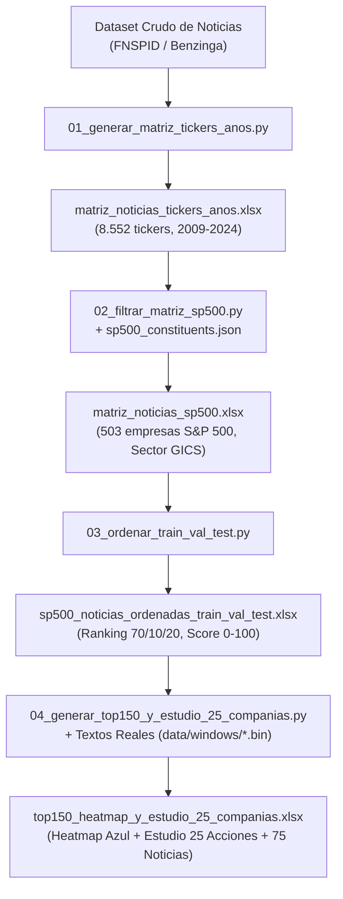

# Pipeline de Selección de Noticias y Filtrado S&P 500 (TFM)

Esta subcarpeta contiene el **ecosistema completo e independiente** de auditoría, filtrado, balance temporal y control de calidad de las noticias financieras utilizadas para entrenar y evaluar el modelo multimodal de predicción de retornos del TFM.

---

## 1. Mapa de Ficheros en esta Carpeta

```
c:/Users/julia/tfm/seleccion_noticias_sp500/
│
├── README.md                                          # Guía ejecutiva y metodológica completa
│
├── 📊 DOCUMENTOS EXCEL (ENTREGABLES):
│   ├── matriz_noticias_tickers_anos.xlsx              # [Paso 1] Universo completo: conteo de noticias por ticker y año (8.552 tickers, 2009-2024)
│   ├── matriz_noticias_sp500.xlsx                     # [Paso 2] Filtrado S&P 500 con nombre y sector GICS (503 empresas)
│   ├── sp500_noticias_ordenadas_train_val_test.xlsx   # [Paso 3] Ranking matemático por idoneidad 70/10/20 y selección de continuas
│   └── top150_heatmap_y_estudio_25_companias.xlsx     # [Paso 4] Top 150 Heatmap + Estudio forense de calidad y 75 noticias reales
│
└── ⚙️ SCRIPTS DE GENERACIÓN REPRODUCIBLES:
    ├── 01_generar_matriz_tickers_anos.py              # Script Paso 1: Extracción y agregación del universo completo
    ├── 02_filtrar_matriz_sp500.py                     # Script Paso 2: Filtro S&P 500, cruce con SEC CIK/GICS y exportación 4 pestañas
    ├── 03_ordenar_train_val_test.py                   # Script Paso 3: Cálculo de splits 70/10/20, desviación y score de idoneidad
    ├── 04_generar_top150_y_estudio_25_companias.py    # Script Paso 4: Heatmap celda a celda en OpenPyXL + estudio de 25 empresas
    └── 05_descargar_noticias_top150_nasdaq.py         # Script Paso 5: Descarga HTTP Range de artículos íntegros NASDAQ (100% Top 150)
```

---

## 2. Flujo Metodológico Paso a Paso



---

## 3. Detalle de los Documentos Excel

### Documento 1: `matriz_noticias_tickers_anos.xlsx`
* **Propósito:** Censo exhaustivo del volumen de noticias para cada activo individual registrado en el dataset.
* **Cobertura:** 8.552 símbolos bursátiles con desglose anual entre 2009 y 2024.
* **Pestañas:**
  1. `Por Volumen (Top Tickers)`: Ordenado por volumen total descendente para identificar los activos con mayor densidad informativa.
  2. `Alfabético (A-Z)`: Búsqueda rápida por símbolo.

### Documento 2: `matriz_noticias_sp500.xlsx`
* **Propósito:** Filtrar exclusivamente los componentes del índice institucional de referencia (**S&P 500**).
* **Cobertura:** 503 empresas del índice oficial con ticker, razón social oficial (`Empresa`) y clasificación sectorial (`Sector GICS`).
* **Pestañas:**
  1. `S&P 500 (Por Volumen)`: Empresas ordenadas de mayor a menor volumen (lideradas por GILD, NVDA, WFC, GOOG, DIS, AAPL).
  2. `S&P 500 (Por Sector)`: Agrupadas por sus 11 sectores económicos para facilitar auditorías sectoriales.
  3. `S&P 500 (Alfabético A-Z)`: Índice alfabético completo.
  4. `Resumen por Sector GICS`: Agregación de noticias por sector y año, mostrando la evolución secular de la cobertura mediática.

### Documento 3: `sp500_noticias_ordenadas_train_val_test.xlsx`
* **Propósito:** Identificar y ordenar qué empresas son idóneas para entrenar modelos de Inteligencia Artificial sin sesgos ni cortes temporales.
* **Reparto Temporal Objetivo (Canónico Machine Learning):**
  * **Train (2009–2018):** ~70% del flujo de noticias.
  * **Val (2019–2020):** ~10% (captura el shock de volatilidad y la pandemia del COVID-19).
  * **Test (2021–2023):** ~20% (evaluación ciega fuera de muestra bajo el régimen de tipos altos e inflación).
* **Métrica de Idoneidad:**
  $$\text{Score} = \text{Score}_{\text{Volumen}} + \text{Score}_{\text{Balance}} \in [0, 100]$$
  donde se penaliza fuertemente la desviación absoluta: $\Delta = |\%_{\text{Train}} - 70| + |\%_{\text{Val}} - 10| + |\%_{\text{Test}} - 20|$.
* **Pestañas Clave:**
  1. `Top Empresas Continuas`: **343 empresas que tienen presencia simultánea en Train, Val y Test** (0 lagunas estructurales).
  2. `Empresas Descartadas`: **160 empresas con cortes severos** (como aquellas que solo tienen noticias a partir de 2021 o que terminaron en 2020).
  3. `Resumen por Sector`: Tasa de éxito de continuidad por sector GICS.

> [!IMPORTANT]
> **Por qué seleccionar las primeras 100 empresas (Ranks 1 al 100):**
> En la pestaña *Top Empresas Continuas*, las primeras 100 empresas garantizan:
> 1. **Cero días mudos en los tres splits.**
> 2. **Ajuste óptimo al patrón 70/10/20.**
> 3. **Representación diversificada y equilibrada de los 11 sectores GICS.**
> 4. **Carteras de deciles robustas:** Permiten formar exactamente 10 deciles ($D_0$ a $D_9$) con **10 activos por decil en cada sesión bursátil**, eliminando el riesgo de concentración idiosincrásico en los extremos *long* y *short*.

### Documento 4: `top150_heatmap_y_estudio_25_companias.xlsx`
* **Propósito:** Visualización de la densidad de noticias y auditoría forense de la calidad lingüística del texto.
* **Pestañas:**
  1. `Top_150_Heatmap`: Las 150 mejores empresas continuas con un **mapa de calor condicional celda a celda** en OpenPyXL (color más oscuro cuantas más noticias tenga el año).
  2. `Estudio_25_Empresas`: Muestra aleatoria estratificada de 25 compañías analizadas a nivel de fila con métricas de palabras en titular y cuerpo (media, mediana, min, max) y porcentaje de artículos de alta calidad vs. boilerplate.
  3. `Muestra_Noticias_Reales`: **75 artículos verbatim reales** (3 por compañía: Alta Calidad, Media/Sectorial y Baja/Boilerplate de bots).
  4. `Resumen_Metodologia_y_Calidad`: Recomendaciones técnicas para la tokenización en LLMs (filtrado de plantillas de opciones y desestimación de ruido sintético).

---

## 4. Instrucciones de Ejecución

Para regenerar cualquier documento desde cero de forma totalmente reproducible, abre una terminal en la raíz del proyecto (`c:\Users\julia\tfm`) y ejecuta los scripts en orden:

```powershell
# Paso 1: Generar matriz general de todos los tickers (si se dispone del archivo crudo)
python seleccion_noticias_sp500/01_generar_matriz_tickers_anos.py

# Paso 2: Filtrar exclusivamente las 503 empresas del S&P 500
python seleccion_noticias_sp500/02_filtrar_matriz_sp500.py

# Paso 3: Calcular splits 70/10/20 y generar el ranking de idoneidad
python seleccion_noticias_sp500/03_ordenar_train_val_test.py

# Paso 4: Construir el Heatmap del Top 150 y el estudio forense de 25 empresas
python seleccion_noticias_sp500/04_generar_top150_y_estudio_25_companias.py

# Paso 5: Descargar los textos íntegros NASDAQ (data/windows/*.bin) para el 100% del Top 150
python seleccion_noticias_sp500/05_descargar_noticias_top150_nasdaq.py
```
